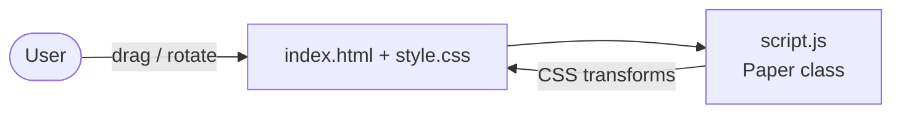

# Drag / Sliding Papers: High-Level Design

A playful page of paper notes you can drag around and rotate, with mouse on desktop and touch on mobile. For code-level detail see the [Low-Level Design](lld.md).

## 1. Context

## 2. Two input versions

| Script | For | Drag | Rotate |
|---|---|---|---|
| `script for pc.js` | Desktop | Left mouse button | Right mouse button, angle follows the cursor |
| `script for phone.js` | Mobile | One finger | Two-finger gesture (`gesturestart` / `gestureend`) |

`index.html` loads `./script.js`, so copy or rename the version you want to `script.js` before serving the page.

## 3. Tech

| Item | Choice |
|---|---|
| Stack | HTML, CSS, vanilla JavaScript (ES class) |
| Rendering | `transform: translateX() translateY() rotateZ()` on each paper |
