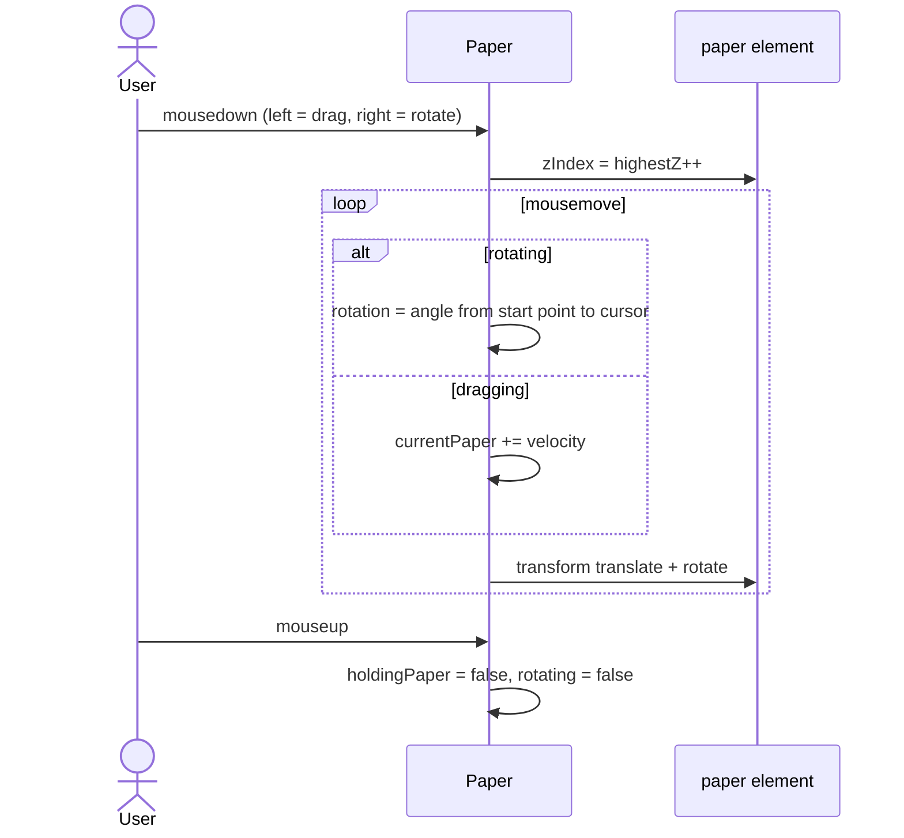

# Drag / Sliding Papers: Low-Level Design

For the big picture see the [High-Level Design](hld.md).

## 1. `Paper` class (desktop version)

| Field | Meaning |
|---|---|
| `holdingPaper` | True while the paper is being dragged |
| `rotating` | True while rotating (right mouse button) |
| `mouseX`, `mouseY`, `prevMouseX`, `prevMouseY` | Current and previous cursor positions |
| `velX`, `velY` | Movement since the last event |
| `mouseTouchX`, `mouseTouchY` | Where the drag started (pivot for rotation) |
| `currentPaperX`, `currentPaperY` | Paper offset |
| `rotation` | Angle in degrees, starts random between −15 and 15 |

Module-level `highestZ` increases on every grab, so the paper you pick up always comes to the front.

## 2. Event flow

## 3. Mobile differences

Uses `touchstart`, `touchmove` (with `preventDefault` to stop page scrolling) and `touchend` on each paper, reading `e.touches[0]`, plus Safari's `gesturestart` / `gestureend` events for two-finger rotation.

## 4. Setup

On load, every `.paper` element gets its own `Paper` instance (`init(paper)`).
